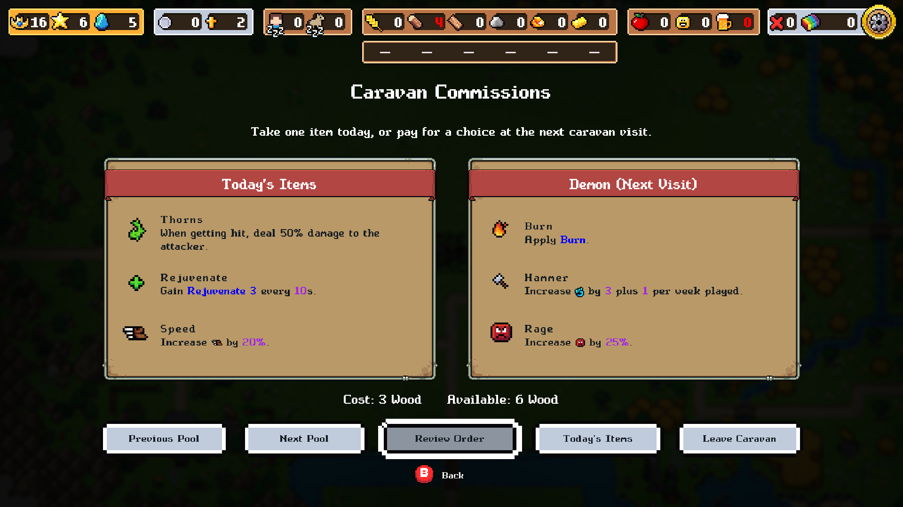
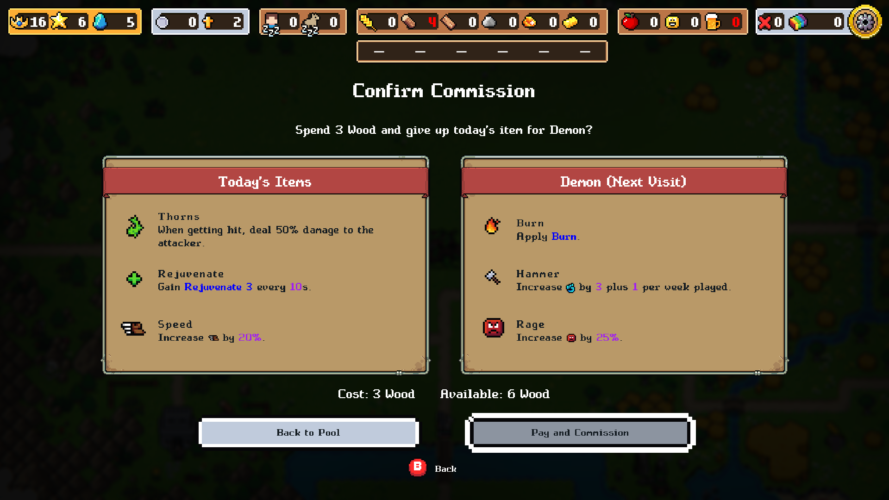
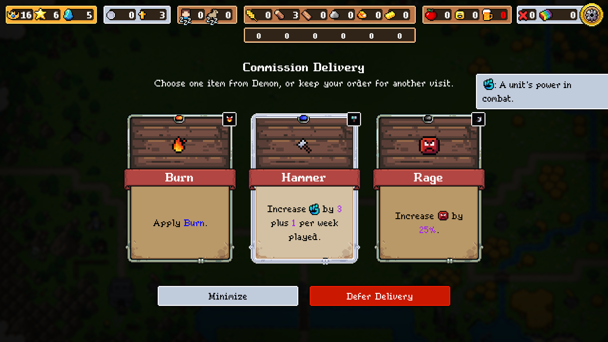

Take an item from today’s caravan, or spend three materials to reserve a choice of three items from another kingdom. You can see exactly which items the next caravan will bring before you pay.

## Features

- Compare today’s cards and their effects with a future offer, side by side.
- See the fee and your available stock together. The caravan asks for three wood, with stone or boards as fallbacks if your kingdom has no wood source.
- Keep one paid order per run. It travels with your run checkpoint through tavern saves and backup restores.

## How to Use

1. At an item caravan, select **Compare Commissions**. Use **Previous Pool** and **Next Pool** to browse other kingdoms, or **Today's Items** to return and take a card now.
2. Select **Review Order** to check the three promised items and the price. **Back to Pool** lets you reconsider. **Pay and Commission** takes the displayed materials once and uses today’s pick.
3. At the next distinct item caravan, choose one of the three delivery cards to receive it as a draggable item. Choose **Defer Delivery** to keep all three choices for a later visit at no extra cost.

On the desk, use the arrow keys or WASD to move focus, **Enter** to activate the focused button, and **Esc** to go back. On a controller, use the D-pad, the bottom face button to confirm, and the right face button to go back (**A** and **B** on Xbox). You can also click a button with the mouse.

## Screenshots

These in-game captures show the same order in version 0.1.0 at 1.5× UI scale, using simulated controller input.

*Compare the two columns. The three cards on the right are the choices you are reserving.*

*Check the stock beside the price before confirming. This order costs 3 of the 6 wood available.*

*Pick one of the promised cards, or use the button beneath them to wait for another visit.*

## Compatibility

Works with the vanilla caravan schedule, including reputation visits, and with Daily Caravan. Reopening the same caravan keeps its original decision. Reloading a checkpoint restores the order and materials as they were at that checkpoint.

Items added by other mods need stable IDs that the game can resolve. If a promised item disappears, you can take a remaining card, defer, or use **Exchange Order** to reserve another complete pool for free. Mods that replace the entire picker or equip rewards directly need a separate integration.

## Installation

1. In Thunderstore Mod Manager or r2modman, select **Super Fantasy Kingdom** and your profile.
2. Install **CaravanCommissions** by **GKJ** along with its listed dependencies, **BepInExPack** and **HideManagerGameObject_Config**. For a local ZIP, install the dependencies and use **Import local mod**.
3. Start the game modded. **Compare Commissions** appears when an item caravan opens.
