# Caravan Commissions

Take an item from today’s caravan, or spend three materials to reserve a choice of three items from another kingdom. Compare the exact choices and see the price before you pay.

## Features

- Compare today’s cards and their effects with a future offer, side by side.
- See the fee and your available stock together. Pay three units of the kingdom material shown on the card, such as Wood for Human or Bone for Undead.
- Keep one paid order per run. Paid choices follow your run checkpoint through saves, Continue, and backup restores.

## How to Use

1. At an item caravan, select **Compare Commissions**. Use the arrows beside the future offer’s heading to browse other kingdoms, or select the **Today’s Items** card to return and take an item now.

   On the desk, move focus with the arrow keys, WASD, or the D-pad. Press **Enter** or the bottom face button (**A** on Xbox) to select. Press **Esc** or the right face button (**B** on Xbox) to go back. You can also click buttons with the mouse. Use **Q/E** or the left and right shoulder buttons to switch pools from anywhere on the comparison desk. The lower-right hints follow the game’s current bindings.

2. Select the **Review Order** card to check the three promised items and the price. **Back** returns to the same pool. **Pay and Commission** takes the displayed materials once and uses today’s pick.
3. At the next distinct item caravan, choose one of the three delivery cards to receive it as a draggable item. Choose **Defer Delivery** to keep all three choices for a later visit at no extra cost.

## Screenshots

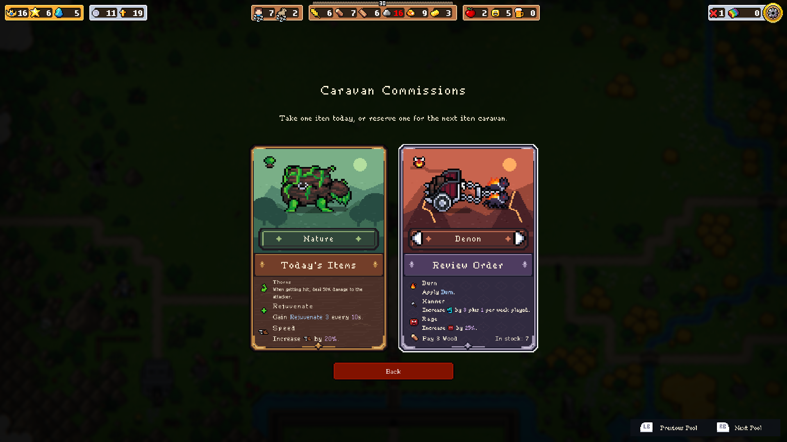

Human at 1×. Compare the visiting Nature caravan with the Demon pool. The price and spendable stock are on the right card.

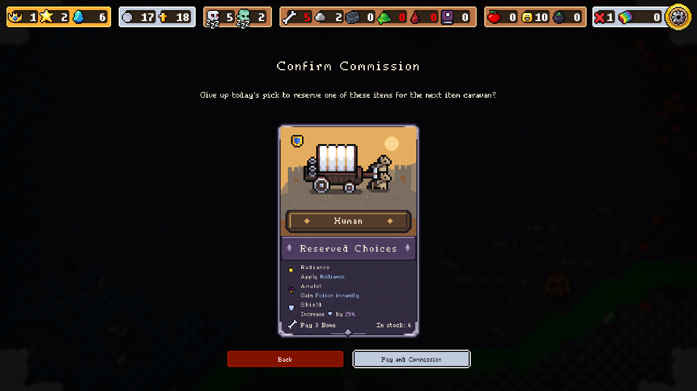

Undead at 1.5×. Review the three promised items and the Bone fee before confirming.

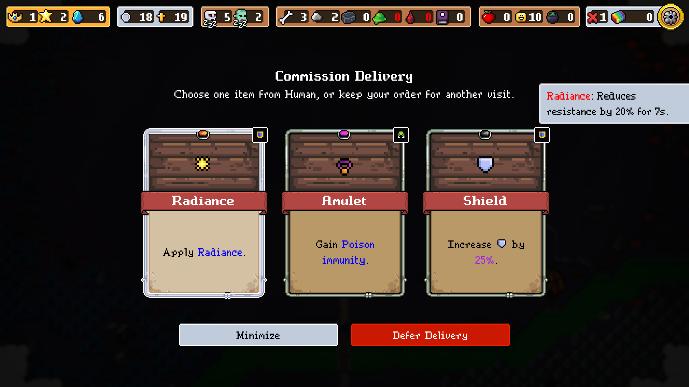

Undead at 1.5×. Choose one prepaid item at the next caravan, or use **Defer Delivery** to keep the order.

### Commission Cards

The bronze **Today’s Items** card returns you to the current stock. The silver **Review Order** card previews a future pool, and **Reserved Choices** shows the final quote. At delivery, choose one prepaid item. The item examples below are from rotating stock.

| Card | Pool | Preview |
| --- | --- | --- |
| Review Order | Human | 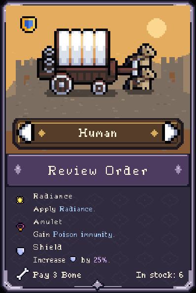 |
| Review Order | Demon | 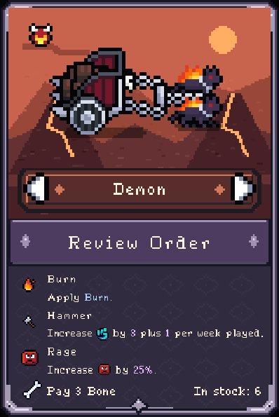 |
| Review Order | Elves | 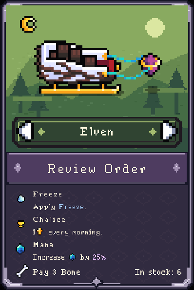 |
| Review Order | Nature | 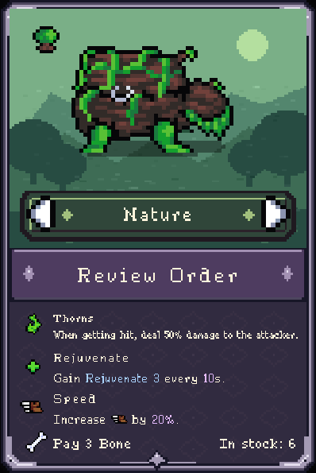 |
| Review Order | Desert | 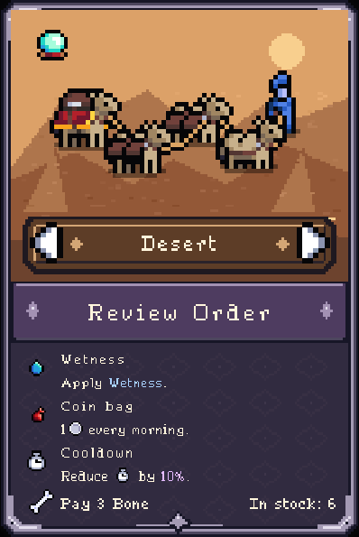 |
| Review Order | Dwarves | 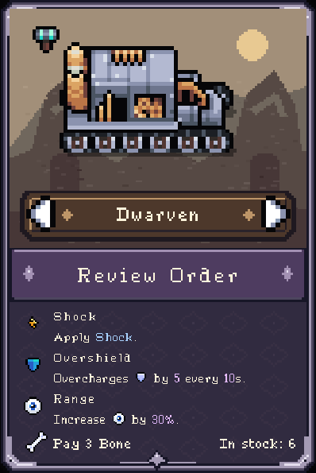 |
| Review Order | Barbarians | 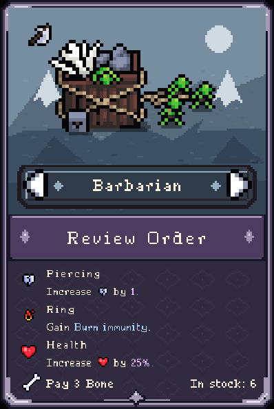 |
| Review Order | Swamp | 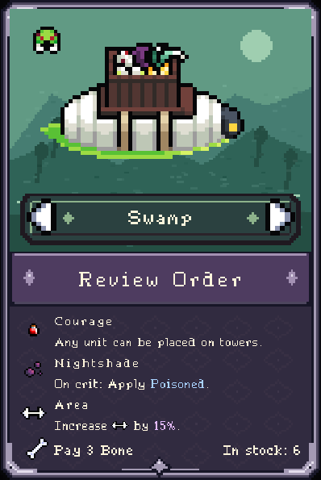 |
| Today's Items | Barbarians | 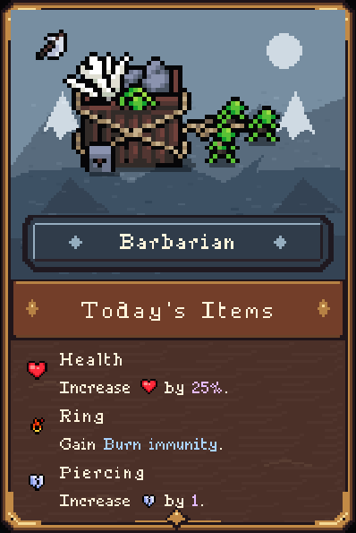 |
| Reserved Choices | Human | 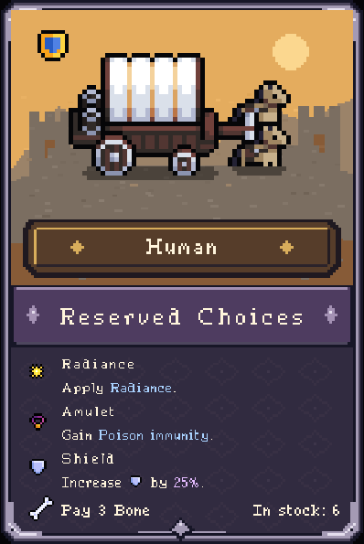 |
| Commission Delivery Radiance | Human | 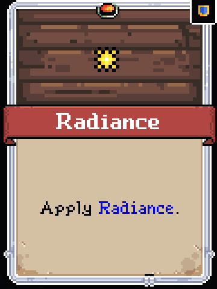 |
| Commission Delivery Amulet | Human | 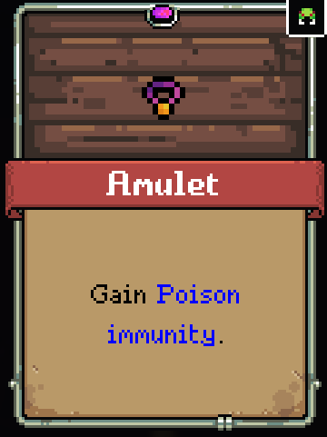 |
| Commission Delivery Shield | Human | 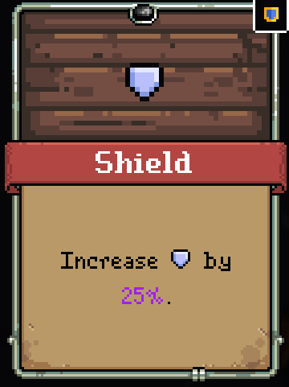 |
| Review Order | Undead | 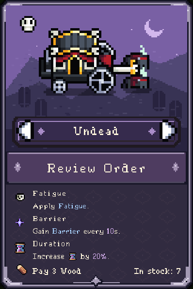 |
| Today's Items | Nature | 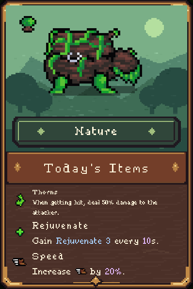 |
| Review Order | Demon | 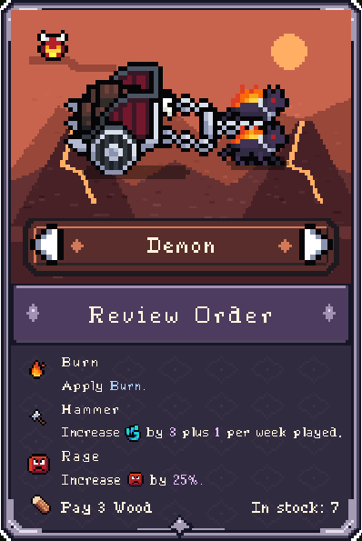 |
| Reserved Choices | Demon | 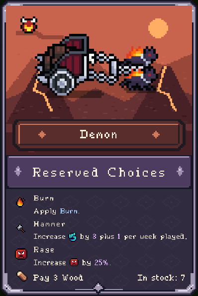 |

## Compatibility

- Verified on Super Fantasy Kingdom **0.8.070** and the other [GKJ mods](https://thunderstore.io/c/super-fantasy-kingdom/p/GKJ/).
- With [Daily Caravan](https://thunderstore.io/c/super-fantasy-kingdom/p/GKJ/DailyCaravan/), delivery follows the next actual item visit. Reopening today’s caravan preserves your decision.
- [Visitor Calendar](https://thunderstore.io/c/super-fantasy-kingdom/p/GKJ/VisitorCalendar/) can show **Commission Forecast**, **Commission Delivery**, or **Next Caravan** when the date is unknown. Collecting the delivery clears the entry.
- With [Kingdom Charters](https://thunderstore.io/c/super-fantasy-kingdom/p/GKJ/KingdomCharters/), the Merchant Charter fee applies to immediate picks. A prepaid commission has no additional fee when you collect it.
- If a promised item is removed by another mod, take a remaining choice, defer, or use **Exchange Order** to reserve another complete pool without paying again. If no replacement pool exists, you can close the order without a refund. Mods that replace the item picker or issue rewards through their own UI may need separate support.
- These community mods can share the same profile. [Achievement Enabler](https://thunderstore.io/c/super-fantasy-kingdom/p/ownlyme/AchievementEnabler/), [Bakery Uses Wheat](https://thunderstore.io/c/super-fantasy-kingdom/p/ownlyme/BakeryUsesWheat/), [More Relics](https://thunderstore.io/c/super-fantasy-kingdom/p/ownlyme/MoreRelics/), [Right Click Skip](https://thunderstore.io/c/super-fantasy-kingdom/p/ownlyme/RightClickSkip/), and [Tavern Food Priorities](https://thunderstore.io/c/super-fantasy-kingdom/p/ownlyme/TavernFoodPriorities/).

## Installation

1. In Thunderstore Mod Manager or [r2modman](https://thunderstore.io/c/super-fantasy-kingdom/p/ebkr/r2modman/), select **Super Fantasy Kingdom** and your profile.
2. Install **CaravanCommissions** by **GKJ** along with its listed dependencies, [BepInExPack](https://thunderstore.io/c/super-fantasy-kingdom/p/BepInEx/BepInExPack/) and [HideManagerGameObject_Config](https://thunderstore.io/c/super-fantasy-kingdom/p/BepInEx/HideManagerGameObject_Config/). For a local ZIP, install the dependencies and use **Import local mod**.
3. Start the game modded. **Compare Commissions** appears when an item caravan opens.

[Support GKJ Games on Ko-fi](https://ko-fi.com/gkj_games)
